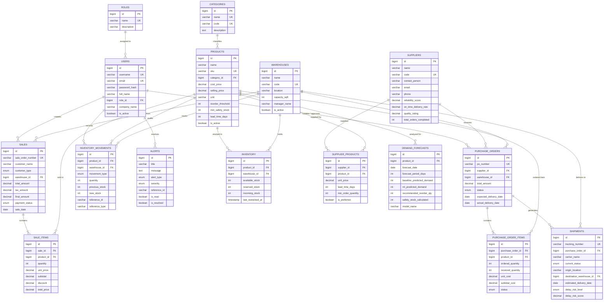

# SupplyStock AI — Entity Relationship (ER) Diagram & Schema Specification

## 1. Relational ER Diagram

## 2. Database Normalization Analysis
- **First Normal Form (1NF)**: Every column holds atomic values. No repeating groups. Each table has a defined primary key (`id`).
- **Second Normal Form (2NF)**: All non-key attributes are fully functionally dependent on the primary key. In intersection entities (`inventory`, `supplier_products`, `sale_items`), attributes depend strictly on the composite or surrogate key.
- **Third Normal Form (3NF)**: Transitive dependencies are removed. Customer and category details are decoupled into distinct relation tables; historical transactional prices are frozen in items tables to prevent dynamic catalog price drift.
